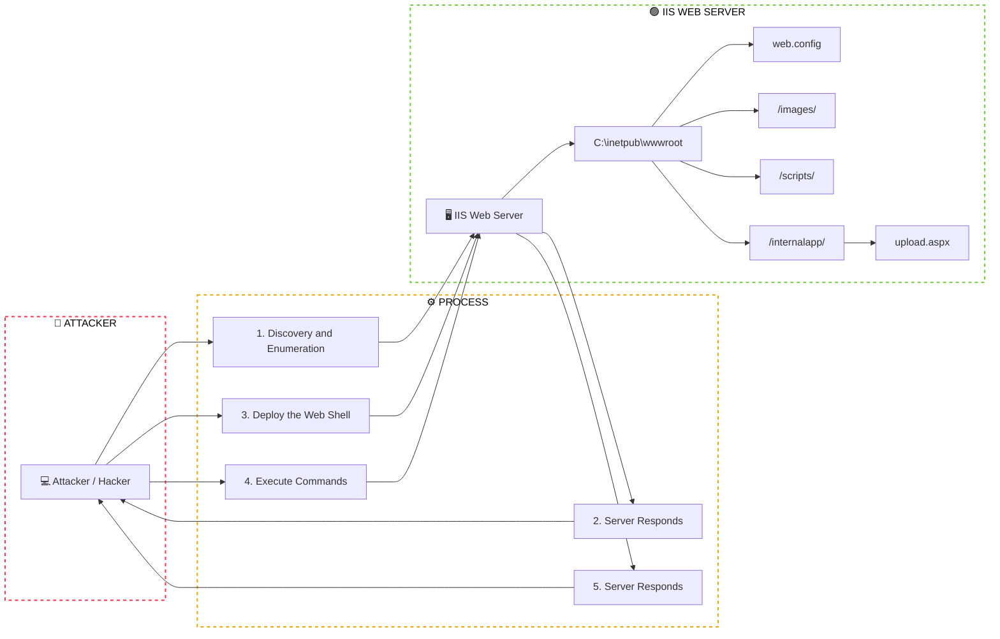

Here is a simple flow chart:





```mermaid
graph LR;
  A["💻 Attacker / Hacker"]

    subgraph DMZ["🔴 DMZ - Demilitarized Zone"]
        direction TB
        B["🌐 Web Application"]
        C["📧 Exchange Server"]
        D["🔥 VPN Gateway"]
    end

    subgraph INTERNAL["🟢 Internal Network"]
        direction TB
        E["🖥️ Domain Controller"]
        F["📁 File Server"]
        G["🗄️ SQL Server"]
        H["👨‍💻 Workstation"]
    end

    A --> B
    A --> C
    A --> D

    B --> E
    C --> E
    D --> E

    E <--> F
    E <--> G
    E <--> H

    E --> I["🚨 IMPACT: ENTIRE DOMAIN"]

    style A fill:#263b63,color:#fff,stroke:#263b63
    style B fill:#e8f5e9,stroke:#7ac943,color:#222
    style C fill:#e8f5e9,stroke:#7ac943,color:#222
    style D fill:#e8f5e9,stroke:#7ac943,color:#222
    style E fill:#d9ecff,stroke:#168bd2,color:#222
    style F fill:#e8f5e9,stroke:#7ac943,color:#222
    style G fill:#e8f5e9,stroke:#7ac943,color:#222
    style H fill:#e8f5e9,stroke:#7ac943,color:#222
    style I fill:#ffe5e5,stroke:#ff334d,color:#d00,stroke-width:3px

    style DMZ fill:#fff,color:#000000,stroke:#ff334d,stroke-width:2px,stroke-dasharray:5 5
    style INTERNAL fill:#fff,color:#000000,stroke:#7ac943,stroke-width:2px,stroke-dasharray:5 5

    linkStyle 0,1,2,3,4,5 stroke:#ff3333,stroke-width:2.5px
    linkStyle 6,7,8,9 stroke:#22aa55,stroke-width:2.5px
