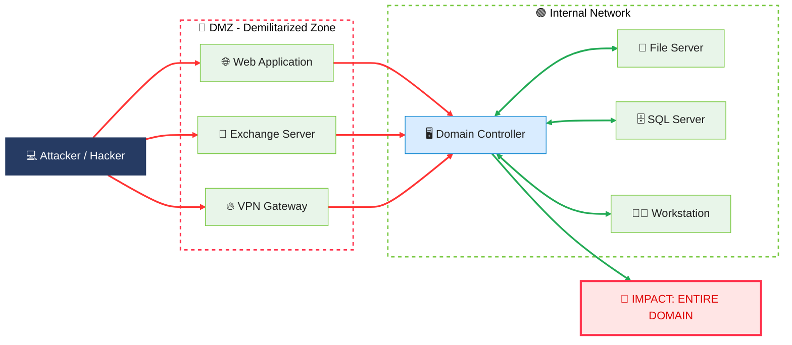
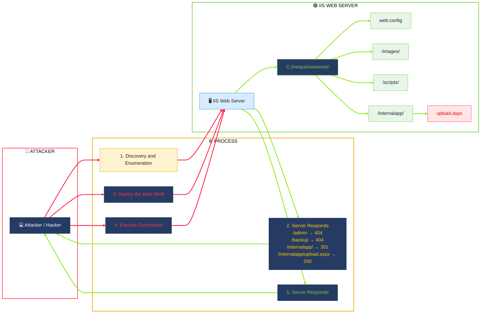
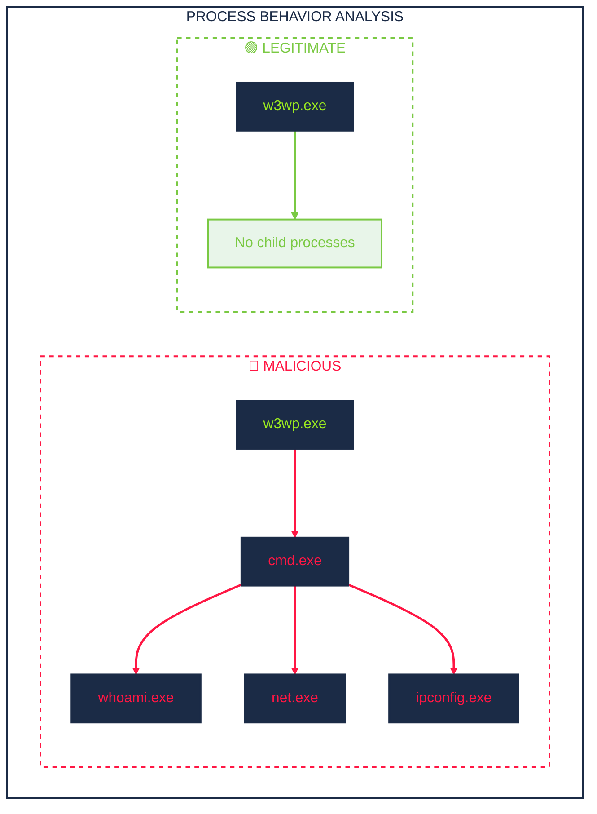
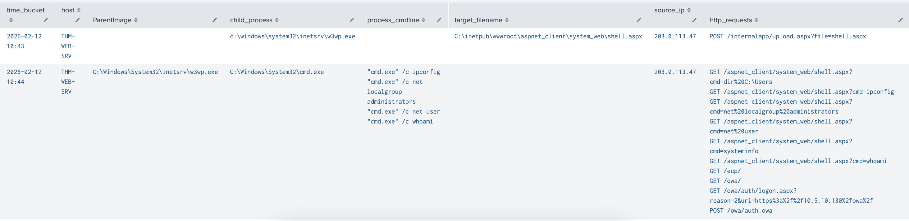
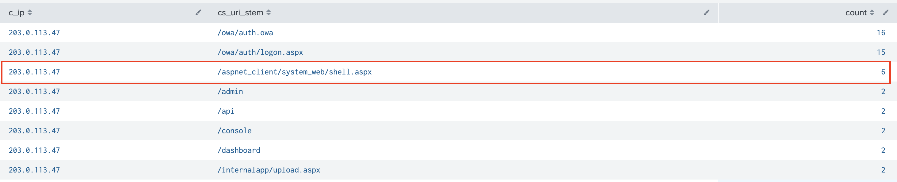
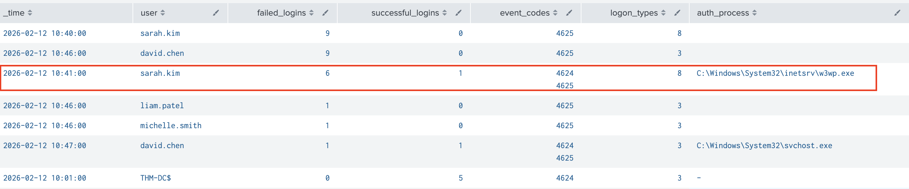
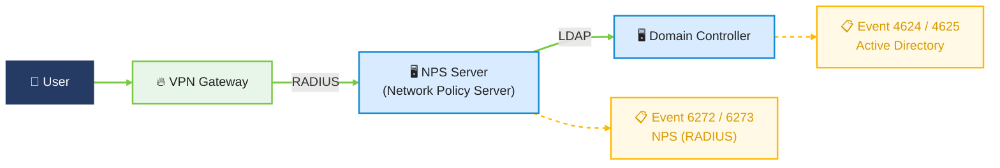

## Initial Access

### Introduction
initial access attacks against 3 of the most common: IIS web applications, Exchange OWA, and VPN gateways




#### Normal vs Suspicious IIS Patterns

| **Pattern** | **Field** | **Normal** | **Suspicious** |
| :--- | :--- | :--- | :--- |
| Authentication volume | `c_ip`, `sc_status` | A few login events per user throughout the day | Hundreds of login attempts from the same IP in minutes |
| Request timing | `c_ip` | 09:15 login from 10.5.10.x (office subnet, business hours) | 03:22 login from 10.99.50.x (unknown subnet, outside hours) |
| URI paths | `cs_uri_stem` | `/owa/`, `/ecp/`, `/internalapp/default.aspx` | `/aspnet_client/system_web/shell.aspx` or `/uploads/cmd.aspx` |
| Query strings | `cs_uri_query` | `?ViewAction=ReadMessage&ItemID=AAM` | `?cmd=whoami` or `?exec=ipconfig` |
| HTTP methods | `cs_method`, `cs_uri_stem` | GET for pages, POST for login forms | POST to `/aspnet_client/shell.aspx` (a static file directory) |
| HTTP status codes | `sc_status`, `c_ip` | Occasional 404s from typos | Hundreds of 404s from a single IP in minutes (directory scanning) |

###  1. Web Shell Attack





#### Detection & Investigation
**1. Find Suspicious IP**

Detection Logic Summary:
- **Error Volume:** More than avg 404 errors per minute.
- **URI Travel:** More than avg distinct URIs requested in the same minute.
- **Interpretation:** A single source IP failing to find a large number of distinct paths is characteristic of a scanner probing for exploitable resources, rather than a normal user encountering broken links.

```
index=iis sc_status=404
| bin _time span=1m
| stats count AS error_count, dc(cs_uri_stem) AS unique_uris BY _time, c_ip
| eventstats avg(error_count) AS avg_error_count, avg(unique_uris) AS avg_unique_uris
| where error_count > avg_error_count AND unique_uris > avg_unique_uris
| fields - avg_error_count, avg_unique_uris
| sort - error_count
```
[](https://github.com/farizrepo/soc/blob/ad0017818337dd5c703cf26a9a9cd9f3c18c7084/source/1.%20finding%20ip.png)

**2. Trace the Process Chain using Sysmon 1 and 11**

Detection Logic Summary:
- **Process Creation (Sysmon 1):** `w3wp.exe` (the IIS worker process) spawning `cmd.exe` or `powershell.exe`.
- **File Creation (Sysmon 11):** `w3wp.exe` writing a `.aspx` file to disk — i.e. a web shell being dropped by the web server itself.
- **Interpretation:** `w3wp.exe` is a long-lived service that only parses HTTP requests; it has no legitimate reason to spawn a command shell or to write executable ASPX content at runtime. Either event in isolation warrants review, but seeing it in the same minute as inbound requests to the host is a strong indicator of web-exploit → web shell / remote code execution, and the paired `http_requests` field usually reveals the exact exploit request.
```
(index=win (EventCode=1 ParentImage="*\\w3wp.exe" Image IN ("*\\cmd.exe", "*\\powershell.exe")) 
 OR (EventCode=11 Image="*\\w3wp.exe" TargetFilename="*.aspx"))
OR
(index=iis)
| eval time_bucket = strftime(_time, "%Y-%m-%d %H:%M")
| eval http_request = if(isnotnull(cs_uri_stem),
      cs_method . " " . cs_uri_stem . if(isnotnull(cs_uri_query), "?" . cs_uri_query, ""),
      null())
| stats values(ParentImage) as ParentImage
        values(Image)          as child_process
        values(CommandLine)    as process_cmdline
        values(TargetFilename) as target_filename
        values(c_ip)           as source_ip
        values(http_request)   as http_requests
        by host, time_bucket
| where (isnotnull(child_process) AND isnotnull(http_requests)) OR isnotnull(target_filename)
| table time_bucket, host, , ParentImage, child_process, process_cmdline, target_filename, source_ip, http_requests
| sort time_bucket
```


#### MITRE ATT&CK Summary
|Tactic        |Technique ID|Technique Name                        |IOC                                                        |
|--------------|------------|--------------------------------------|-----------------------------------------------------------|
|Reconnaissance|T1595.003   |Wordlist Scanning                     |Source IP: 203.0.113.47; 74 unique URIs; 74 HTTP 404 errors|
|Initial Access|T1190       |Exploit Public-Facing Application     |POST /internalapp/upload.aspx?file=shell.aspx              |
|Persistence   |T1505.003   |Web Shell                             |C:\inetpub\wwwroot\aspnet_client\system_web\shell.aspx     |
|Execution     |T1059.003   |Windows Command Shell                 |Parent: w3wp.exe; Child: cmd.exe                           |
|Discovery     |T1016       |System Network Configuration Discovery|Command: ipconfig                                          |
|Discovery     |T1033       |System Owner/User Discovery           |Command: whoami                                            |
|Discovery     |T1087.001   |Account Discovery: Local Account      |Command: net user                                          |

### 2. OWA Exchange Server (On-Premise) Attack
#### Detection & Investigation
**1. OWA Authentication Endpoint Abuse**

Detection Logic Summary:
- **Subsearch (Baseline):** Count POST requests per source IP to `/owa/auth.owa` and keep only IPs exceeding 10 hits.
- **Correlation:** Re-scan all IIS logs for those flagged IPs and break down their traffic by `c_ip` and `cs_uri_stem`.
- **Interpretation:** `/owa/auth.owa` is the OWA login handler; legitimate users POST to it once per sign-in attempt. An IP firing dozens of POSTs at that single endpoint is characteristic of password spraying or credential stuffing against Exchange — the per-URI breakdown confirms the traffic is concentrated on the auth handler rather than normal browsing, and the `c_ip` set identifies the spraying sources to block or investigate further.

```
index=iis [
    search index=iis cs_uri_stem="/owa/auth.owa" cs_method=POST
    | stats count by c_ip
    | where count > 10
    | stats values(c_ip) as c_ip
]
| stats count by c_ip, cs_uri_stem
| sort - count
```


**2. Failed-then-Successful Logon Sequence (Brute Force → Compromise)**

Detection Logic Summary:
- **Error Volume:** Per-minute count of `4625` (failed logon) events per `user`.
- **Success Signal:** Per-minute count of `4624` (successful logon) events for the same `user`, in the same bucket.
- **Enrichment:** `Logon_Type` and `Process_Name` are carried along to distinguish interactive vs. network vs. service logons and to spot non-standard auth processes.
- **Interpretation:** A spike of failed logons is brute force in progress; the presence of successful logons in the same minute for the same account is the classic "brute force succeeded" pattern — the last row with `failed_logins > 0 AND successful_logins > 0` is the moment of compromise to pivot from. Sorting by `failed_logins` descending puts the noisiest spray targets at the top for triage.

```
index=win EventCode IN (4624, 4625)
| bin _time span=1m
| stats count(eval(EventCode=4625)) as failed_logins
        count(eval(EventCode=4624)) as successful_logins
        values(EventCode)   as event_codes
        values(Process_Name) as auth_process
        values(Logon_Type)   as logon_types
        by _time, user
| table _time, user, failed_logins, successful_logins, event_codes, logon_types, auth_process
| sort - failed_logins
```


#### MITRE ATT&CK Summary
|Tactic           |Technique ID|Technique Name          |IOC / Evidence                                                                                                                      |
|-----------------|------------|------------------------|------------------------------------------------------------------------------------------------------------------------------------|
|Initial Access   |T1133       |External Remote Services|Exchange OWA authentication endpoint abuse: POST /owa/auth.owa from source IP 203.0.113.47 (16 requests).                           |
|Credential Access|T1110       |Brute Force             |Repeated authentication attempts against OWA. User sarah.kim recorded 9 failed logins at 10:40 and another 6 failed logins at 10:41.|
|Credential Access|T1110.001   |Password Guessing       |Multiple failed authentication attempts against sarah.kim (Event ID 4625), followed by a successful authentication event.           
|Initial Access   |T1078       |Valid Accounts          |User sarah.kim recorded 1 successful logon (Event ID 4624) at 10:41, alongside 6 failed logons in the same minute.                  |

### 3.VPN Credential Attack


#### Detection & Investigation

**1. Find the Compromised Account by looking at NPS denial events**
```
index=win EventCode IN (6272,6273)
| bin _time span=5m
| stats count(eval(EventCode=6273)) as denied
        count(eval(EventCode=6272)) as granted
        values(Client_IP_Address) as client_ips
        by _time, User_Account_Name
| table _time, User_Account_Name, denied, granted, client_ips
| sort - denied
```
****

**2. Correlating Compromised Account with  Security Logon Events**

```
index=win EventCode IN (4624, 4625) user={COMPROMISED_ACCOUNT}
| table _time, host, user, EventCode, Logon_Type
| sort _time

```

 #### MITRE ATT&CK Summary
