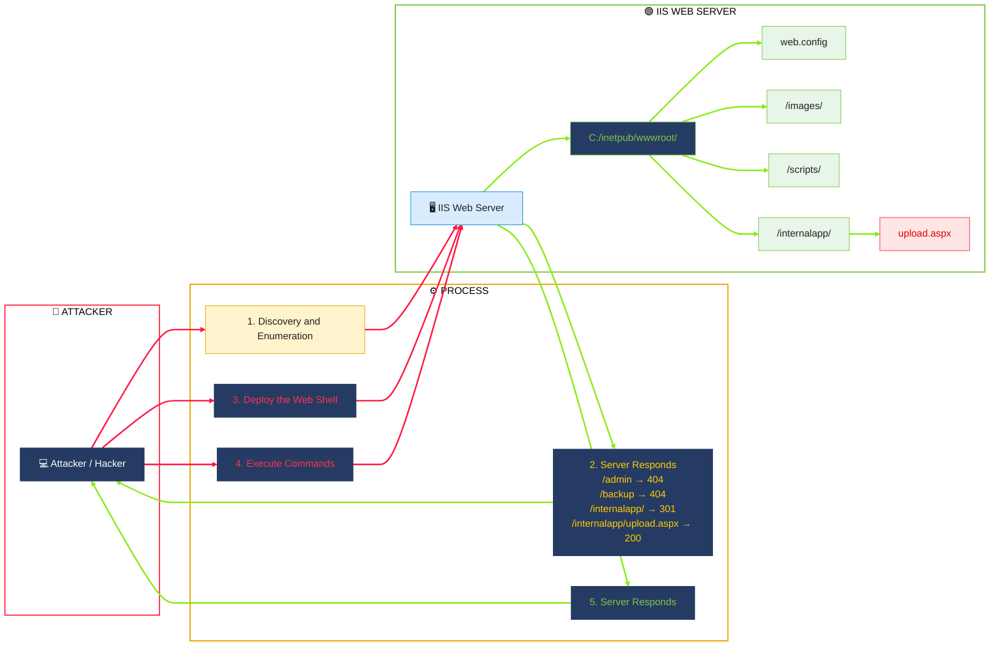
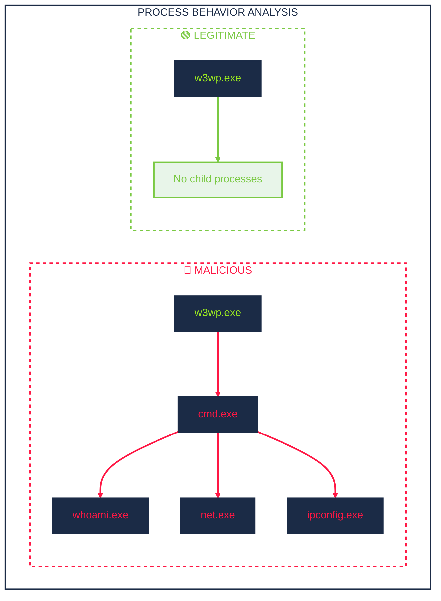

## Initial Access

### Introduction
initial access attacks against 3 of the most common: IIS web applications, Exchange OWA, and VPN gateways
#### Normal vs Suspicious IIS Patterns

| **Pattern** | **Field** | **Normal** | **Suspicious** |
| :--- | :--- | :--- | :--- |
| Authentication volume | `c_ip`, `sc_status` | A few login events per user throughout the day | Hundreds of login attempts from the same IP in minutes |
| Request timing | `c_ip` | 09:15 login from 10.5.10.x (office subnet, business hours) | 03:22 login from 10.99.50.x (unknown subnet, outside hours) |
| URI paths | `cs_uri_stem` | `/owa/`, `/ecp/`, `/internalapp/default.aspx` | `/aspnet_client/system_web/shell.aspx` or `/uploads/cmd.aspx` |
| Query strings | `cs_uri_query` | `?ViewAction=ReadMessage&ItemID=AAM` | `?cmd=whoami` or `?exec=ipconfig` |
| HTTP methods | `cs_method`, `cs_uri_stem` | GET for pages, POST for login forms | POST to `/aspnet_client/shell.aspx` (a static file directory) |
| HTTP status codes | `sc_status`, `c_ip` | Occasional 404s from typos | Hundreds of 404s from a single IP in minutes (directory scanning) |

###  Web Shell Attack
#### Mitre Attack Mapping
| Behavior | Tactic | Technique ID & Name |
| --- | --- | --- |
| Exploiting the IIS application to gain access | Initial Access | T1190: Exploit Public-Facing Application |
| w3wp.exe spawning cmd.exe/powershell.exe to run commands | Execution | T1059: Command and Scripting Interpreter |
| Deploying the .aspx web shell for persistent access | Persistence | T1505.003: Server Software Component: Web Shell |




#### Detection & Investigation
```
index=iis sc_status=404
| bin _time span=1m
| stats count AS error_count, dc(cs_uri_stem) AS unique_uris BY _time, c_ip
| where error_count > 30 AND unique_uris > 20
| sort - error_count
```
[](https://github.com/farizrepo/soc/blob/ad0017818337dd5c703cf26a9a9cd9f3c18c7084/source/1.%20finding%20ip.png)




```mermaid
graph LR;
  A["💻 Attacker / Hacker"]

    subgraph DMZ["🔴 DMZ - Demilitarized Zone"]
        direction TB
        B["🌐 Web Application"]
        C["📧 Exchange Server"]
        D["🔥 VPN Gateway"]
    end

    subgraph INTERNAL["🟢 Internal Network"]
        direction TB
        E["🖥️ Domain Controller"]
        F["📁 File Server"]
        G["🗄️ SQL Server"]
        H["👨‍💻 Workstation"]
    end

    A --> B
    A --> C
    A --> D

    B --> E
    C --> E
    D --> E

    E <--> F
    E <--> G
    E <--> H

    E --> I["🚨 IMPACT: ENTIRE DOMAIN"]

    style A fill:#263b63,color:#fff,stroke:#263b63
    style B fill:#e8f5e9,stroke:#7ac943,color:#222
    style C fill:#e8f5e9,stroke:#7ac943,color:#222
    style D fill:#e8f5e9,stroke:#7ac943,color:#222
    style E fill:#d9ecff,stroke:#168bd2,color:#222
    style F fill:#e8f5e9,stroke:#7ac943,color:#222
    style G fill:#e8f5e9,stroke:#7ac943,color:#222
    style H fill:#e8f5e9,stroke:#7ac943,color:#222
    style I fill:#ffe5e5,stroke:#ff334d,color:#d00,stroke-width:3px

    style DMZ fill:#fff,color:#000000,stroke:#ff334d,stroke-width:2px,stroke-dasharray:5 5
    style INTERNAL fill:#fff,color:#000000,stroke:#7ac943,stroke-width:2px,stroke-dasharray:5 5

    linkStyle 0,1,2,3,4,5 stroke:#ff3333,stroke-width:2.5px
    linkStyle 6,7,8,9 stroke:#22aa55,stroke-width:2.5px
